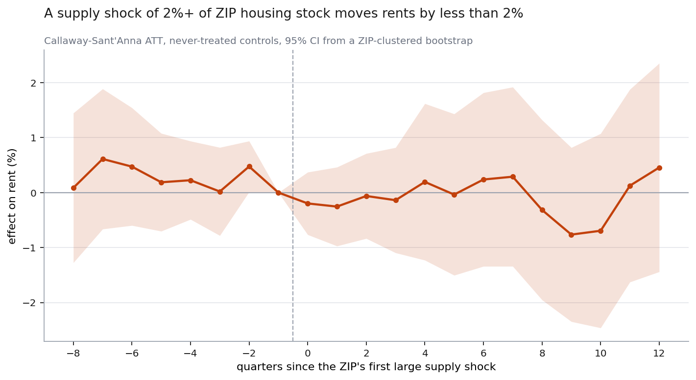
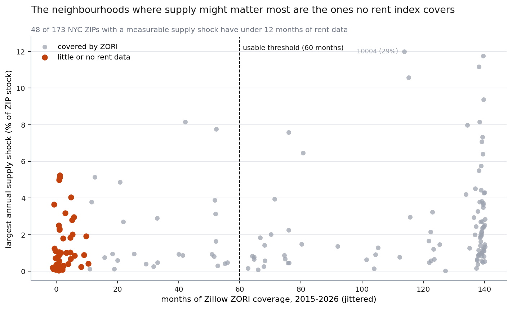

# Does new construction lower nearby rents?

New York City added **376,587 net housing units** across **29,940 completed projects**
between 2012 and 2025. This repo asks what those units did to rents in the ZIP codes that
received them, using a Callaway–Sant'Anna event study on a **71-ZIP × 47-quarter panel**
built entirely from live public data.

The headline is a null, and the null is the point: **a supply shock of 2% or more of a ZIP's
housing stock moves rents by less than 2% in either direction, for at least three years
afterward.** Parallel trends survive testing, so this is a bound rather than a shrug.



The second finding is about the data rather than the housing market, and it may be the more
useful one: **48 of the 173 NYC ZIPs with a measurable supply shock have under 12 months of
rent data.** They are not a random 48.



---

## What was estimated

Treatment is a ZIP whose trailing-four-quarter housing completions reach **2% of its existing
residential stock**. Cohort `g` is the first quarter that threshold is crossed. The comparison
group is ZIPs that never exceed 1% in any four-quarter window. For cohort `g`, period `t`, and
baseline `b = g − 1`:

```
ATT(g,t) = E[Y_t − Y_b | G = g] − E[Y_t − Y_b | never treated]
```

Event-time estimates average `ATT(g, g+e)` across cohorts, weighted by cohort size. Standard
errors come from a nonparametric bootstrap that resamples whole ZIPs, since that is the level
treatment is assigned at. The estimator is written out in [`src/nycsupply/did.py`](src/nycsupply/did.py)
rather than imported, so the identifying comparison is visible.

| | |
|---|---|
| Treated ZIPs | 45 |
| Never-treated ZIPs | 26 |
| Rent observations | 2,927 |
| Average post-treatment ATT | **−0.0009 log points (−0.09% rent)** |
| Pre-trend joint test | χ²(7) = 7.33, **p = 0.396** |
| MDE at +4q / +8q / +12q (80% power) | 2.04% / 2.34% / 2.71% |

Nothing is significant at any horizon from 0 to +12 quarters. Nothing is significant before
treatment either, which is what makes the post-treatment zero worth reading.

## Why a null is the finding

The building-level literature — Asquith, Mast & Rambachan most prominently — finds rents
falling roughly 5–7% **within 500 metres** of a new market-rate building. That is not in
conflict with this result. A 500m effect spread across an entire ZIP code would land far below
the ~2% floor this design can detect. The two results describe different geographies.

What this panel *can* rule out is the strong claim in either political direction: that
building at scale collapses neighbourhood rents, or that it drives them up through amenity
effects. Over three years, at ZIP scale, neither shows up. The honest statement is a bound,
and the MDE is reported so the bound is interpretable.

## Robustness

The control-group boundary is the one genuinely arbitrary choice, so it is swept:

| control threshold | treated | controls | ATT (0 to +8q) | se | pre-trend p |
|---|---|---|---|---|---|
| 0.75% | 45 | 16 | −0.0027 | 0.0072 | 0.34 |
| 1.00% | 45 | 26 | −0.0003 | 0.0060 | 0.36 |
| 1.25% | 45 | 33 | −0.0014 | 0.0060 | 0.38 |
| 1.50% | 45 | 41 | −0.0030 | 0.0055 | 0.22 |

A continuous-dose TWFE distributed lag is reported in `outputs/dose_response.csv` as a
specification check. Its leads are flat (no anticipation) and its lags are indistinguishable
from zero, consistent with the main result. It is **not** the headline: TWFE is biased under
staggered, repeated, continuous treatment, and treatment here is all three — Long Island City
crosses the shock threshold in nine separate years.

## The trap that would have broken this

Hunters Point (11109) took supply shocks of 17–24% of stock in 2012–2014. Zillow's rent series
starts in 2015. A panel that begins when the outcome begins therefore sees 11109 as having
**zero** supply activity and files it as a pristine never-treated control — one of the cleanest
in the city, and completely contaminated.

Twenty-five ZIPs fall into this category. They are excluded from the control pool by checking
completions in the three years *before* the panel opens. Without that check the comparison
group is quietly poisoned by exactly the neighbourhoods that got the biggest shocks.

## The coverage problem

Zillow publishes ZORI where the rental market is thick enough to support an index. Thickness
correlates with price. So coverage is a function of the outcome:

| ZIPs | Max annual shock | Months of ZORI |
|---|---|---|
| Hunts Point, Starrett City, S. Ozone Park, Tremont, Wakefield | 2.3–5.2% | **0** |
| Far Rockaway, Riverdale, Soundview | 2.3–5.1% | 1–5 |
| Four Bronx ZIPs (10452, 10455, 10459, 10453) | 2.8–4.0% | 4–5 |
| LIC, Downtown Brooklyn, Hudson Yards, FiDi, Williamsburg | 7.1–29.4% | 115–139 |

The estimable sample is therefore **market-rate development in already-expensive
neighbourhoods**. The result generalises to that and not to housing supply in general. This is
selection in whether the outcome *exists at all*, which no amount of controlling fixes — the
rows are simply absent. Any paper using ZORI for distributional questions about housing
inherits this and mostly does not say so.

## Data

> The raw inputs are not in this repository. [DATA.md](DATA.md) records exactly which files were used, with sizes and fingerprints, and how to re-fetch them.

All sources are public and require no authentication (verified 2026-08-23).

| Piece | Source | Scale |
|---|---|---|
| Completions | NYC HousingDB project-level, Socrata `br6q-ssj3` | 29,940 jobs, 376,587 net units |
| Rent index | Zillow ZORI ZIP-level, `Zip_zori_uc_sfrcondomfr_sm_month.csv` | 139 months, 163 NYC ZIPs |
| Housing stock | NYC PLUTO, Socrata `64uk-42ks` | 856,463 lots, 3,741,843 units |

Completions join to ZIP through **BBL → PLUTO → zipcode**, matching **99.7% of jobs and 99.2%
of units** — cleaner than a spatial join on the point geometry, and no boundary file needed.
The Census ACS is deliberately not used: `api.census.gov` now requires a key, and PLUTO gives
a lot-level denominator from the same administrative source as the permits.

Every raw file is cached under `data/raw/` with a `manifest.json` recording its URL, fetch
timestamp, size and SHA-256.

## Running it

```bash
pip install -r requirements.txt
python scripts/01_fetch_pluto.py      # ~858k lots, paginated
python scripts/02_fetch_housingdb.py
python scripts/03_fetch_zori.py
python scripts/04_build_panel.py
python scripts/05_estimate.py
python scripts/06_figures.py
```

Fetches are cached and idempotent; pass `--force` to refresh. `pytest tests/` validates the
estimator against panels with a planted effect — it recovers a known −5% shift, and its
pre-trend test detects a planted differential trend. Simulated data appears only in the tests,
where the point is verifying a known property; every reported finding is estimated on the real
panel.

## Limitations

- **Geography.** ZIP codes are far coarser than the 500m rings the literature uses. This
  design cannot see a local effect and does not claim to.
- **Index composition.** New buildings enter the ZORI basket and are expensive, which pushes
  the measured effect upward independent of any market movement. ZORI's repeat-listing
  weighting is a partial defence, not a complete one.
- **Power.** 45 treated ZIPs supports a ~2% detection floor. Effects smaller than that are
  invisible here.
- **Completion timing is endogenous.** Developers finish faster into strong markets. The
  natural next step is to instrument completion timing with permit-issuance date plus typical
  construction lag; `datepermit` is carried through the pipeline for exactly this.

See [SCOPE.md](SCOPE.md) for the design document written before estimation, including the
feasibility numbers that set the thresholds used here.
